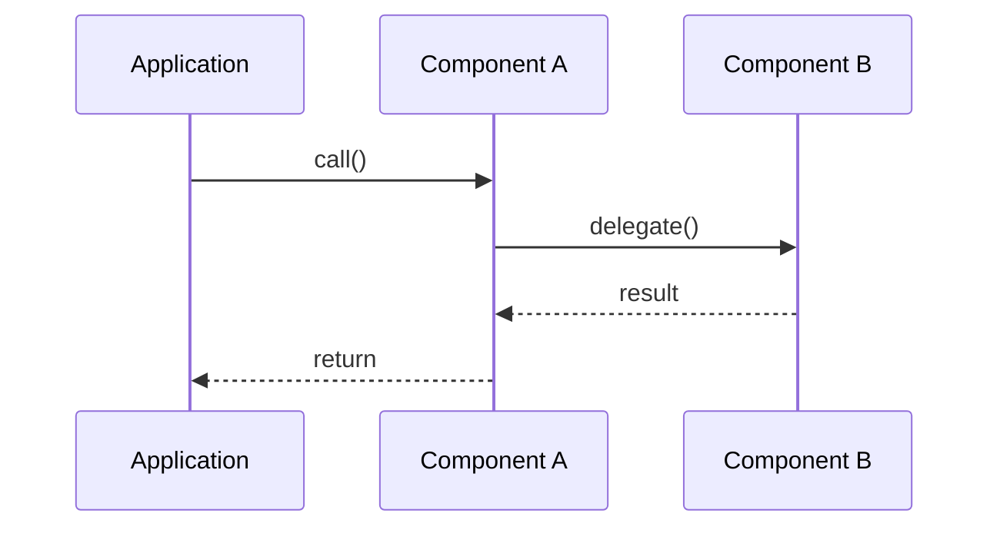

# 调用链：功能名称

## 1. 研究问题

例如：一次同步日志调用如何到达控制台输出？

## 2. 入口与触发条件

- 用户可见 API：
- 入口文件/符号：
- 前置状态：

## 3. 调用链

| 顺序 | 文件:行号 / 符号 | 输入 | 做了什么 | 输出/下一跳 |
|---|---|---|---|---|
| 1 | | | | |
| 2 | | | | |
| 3 | | | | |

## 4. 时序图

## 5. 数据与所有权变化

- 关键对象：
- 谁创建：
- 谁持有：
- 是否转移所有权：
- 谁销毁：

## 6. 并发与错误路径

- 是否跨线程：
- 是否加锁/原子操作：
- 失败路径：
- 重试、丢弃或传播策略：

## 7. 设计结论

这条调用链体现了什么职责边界？它如何支持扩展或隔离变化？有什么成本？

## 8. 源码证据

记录版本/commit、文件路径、类/函数和必要的行号。避免只贴大段源码。
